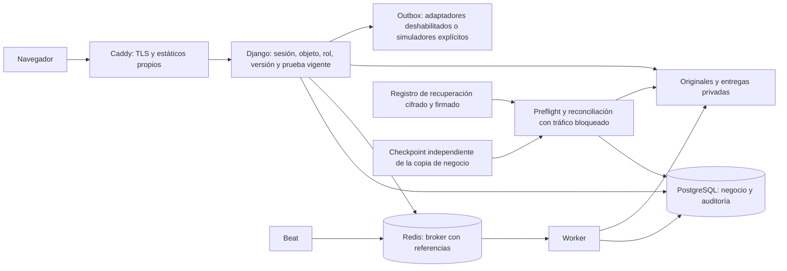

# Revisión técnica local de seguridad y operación — B-B, 2026-10-19

Revisor: Codex principal. Alcance: mecanismos del MVP sintético de contrato16, IMP001–011 y OP001–009; no auditoría externa ni certificación jurídica. Las decisiones de producción G01–08 permanecen separadas. La [vinculación verificable](evidencias/bb-security-current-binding-20261019.json) registra versiones, fuentes, nodeids realmente PASS y límites; los grupos se solapan y su cantidad no sustituye las aserciones.

Base común: `e99dc962c6403e23e53b7bfb00b2442aef3ac341`, funcional `20261019-095237-9bf4f4f2` y capacidad `20261019-124016-c5996270`. Producto sin cambios respecto al corte integrado; dos módulos de pruebas extendidos y un nuevo módulo de configuración requieren la batería final C. La ampliación geográfica y la restauración cifrada tienen pruebas focused independientes; no se suman como una nueva N3 común. Las quince fuentes de la revisión de seguridad CR09 conservan sus SHA.

## Fronteras y usos indebidos

Visitante consulta sólo revisión aprobada y derivado autorizado; particular gestiona su ámbito; propietario/editor de agencia requiere relación vigente y versión; moderador/revisor necesita permiso funcional y asignación/lectura con finalidad; administrador no representa al sujeto por ser administrador. Proveedores y atacante se consideran fuera del ámbito confiable. Worker y broker no otorgan autoridad: las tareas revalidan estado y las colas transportan referencias. El checkpoint es independiente en el ensayo; no se acredita custodia externa.

Prioridades revisadas: P1 toma de cuenta o recuperación débil (IMP003), acceso cruzado y autoridad revocada (IMP002/006), publicación/retirada inválida y restauración que reintroduzca datos (IMP005–008/010). P2 contenido activo, inyección y agotamiento de recursos (IMP004/007/009), manipulación de evidencia y filtración de logs (IMP009/010). Cada riesgo se vincula abajo a controles negativos, no sólo al recorrido válido. Similitud no prueba identidad ni propiedad; actividad elevada no prueba bot.

## Inventario de activos, finalidad, acceso y conservación

| Activo / clasificación | Finalidad y acceso | Conservación y verificación técnica |
| --- | --- | --- |
| Revisión aprobada, ubicación pública, tarifa, contacto autorizado y derivado / público personal | Descubrimiento y publicación; sólo estado visible y consentimiento/gestión vigentes. Borradores y revisiones pendientes excluidos | Caducidad/retirada y reconstrucción de proyección conservadora; pruebas lifecycle/publication_state/discovery/public_seo/sitemaps. No garantía sobre copias de buscadores ajenos |
| Cuenta, correo, sesiones, tokens, MFA y membresía / privado | Autenticación y gestión autorizada; hash Argon2, secreto MFA cifrado, códigos de recuperación protegidos; no inventario que exporte secretos | Caducidad/uso único de tokens; epoch revoca sesiones; supresión por finalidad y preservación de otros roles. accounts/agencies_mfa/account_email_confirmation y casos de supresión de cuenta |
| Teléfono canónico, representación y resultado de verificación / privado salvo contacto autorizado | Control de canal, relación de gestor y condición de publicación; proveedor simulado separado de identidad real | Versiones de consentimiento/gestor y vigencia de prueba; retiro invalida autorización; verification y revocation_races. No acumular documentos de identidad originales |
| Originales, huellas y referencias de fotos / privado | Validar/recodificar y detectar candidatos de duplicado; derivado público sólo con aprobación | Purga de preparaciones vencidas, medios suprimidos y objetos huérfanos; referencias compartidas conservadas cuando corresponda. photos/preparation_cleanup/media_erasure/shared_media_redaction |
| Denuncias, reclamaciones, pruebas, mensajes y copias de derechos / restringido | Resolver expediente y derechos, con asignación, permiso, finalidad y prueba vigente; cuerpos cifrados, consultas auditadas | Inventario por modelo/finalidad y plan explícito de borrar/bloquear/conservar/revisar; caducidades de cuerpos temporales. RetentionReview no amplía el plazo jurídico ni ejecuta borrado. rights_coverage_audit_projection/retention_calendar y matriz88 |
| Contadores HMAC, IDs de trabajo y diagnóstico / operacional restringido | Límites de abuso y diagnóstico mínimo; IP no se acepta desde XFF del cliente, datos sensibles excluidos de logs | Ventanas de rate limit y tareas acotadas; no caché compartida de respuesta privada. private_logging y recovery_broker_namespace. Retención productiva de logs y responsable pendientes |
| Eventos de auditoría, evidencias, outbox y registro de recuperación / restringido | Trazabilidad e idempotencia, reconciliar derechos después de restaurar | ACL runtime, cadena append-only, integridad y checkpoint; conservar metadatos mínimos sin confundirlos con cuerpos temporales. rights_evidence_chain/recovery_*; plazos jurídicos definitivos por responsable pendientes |
| Copia completa PostgreSQL/medios y claves / restringido de operación | Recuperación aislada; archivo autenticado cifrado, clave fuera del archivo y ledger | Ensayo real plain-local/encrypted-local, negativos de clave e integridad y RPO/RTO del fixture. Cadencia, expurgo de copias, custodia/offsite y recuperación de claves productivas pendientes; sin PITR acreditado |

El inventario detallado por sujeto, modelo y finalidad está implementado en `apps/safety/erasure_inventory.py`, `account_erasure_inventory.py`, los inventarios de derechos y su censo probado. Preparar inventario devuelve review_required y execution_ready=False: no equivale a autorizar ni ejecutar supresión. Plan, lectura actual y ejecución son pasos distintos. Los plazos de fixtures están versionados en su política sintética; no se presentan como ley ni como política productiva aprobada.

## Decisiones IMP001–011

| ID | Implementación y evidencia examinadas | Resultado local y límite |
| --- | --- | --- |
| IMP001 | Mapa e inventario anterior; census/rights_coverage_audit_projection comprueba modelos, ámbito y fuente; inventarios no exponen secretos | Mecanismo y fronteras documentados; producción requiere registro de tratamientos y finalidad/base/plazo definitivos |
| IMP002 | agencies/verification/rights_scope/rights_verification: denegar por objeto, miembro vigente, manager_version, sesión/MFA y locks. drafts, agencies_mfa, revocaciones específicas y carreras reales | Acceso ajeno/revocado y replay sin autoridad rechazados; moderación no implica acceso universal |
| IMP003 | accounts/mfa/middleware: Argon2, tokens caducos/de un uso, respuestas genéricas, CSRF, límites PostgreSQL, TOTP/códigos y consumo atómico; accounts/agencies_mfa/account_email_confirmation | Mecanismos locales probados; entrega/identidad real y soporte humano no se acreditan con simuladores |
| IMP004 | Texto plano, escape y CSP común; JSON-LD serializado inerte y sin borradores; consultas ORM parametrizadas y filtros acotados; public_structured_data, drafts, report_history y rights_messages | Entradas activas/CSRF/fragmentos probados; importación de imágenes por URL fuera del MVP. No lista nueva de excepciones CSP |
| IMP005 | services/similarity: límite10MiB/ocho fotos, tipo real y recodificación, procesamiento fallido cerrado, hashes y confirmación geométrica; photos/image_similarity/preparation_cleanup | Cinco variantes positivas, diez imágenes ajenas y control plano/pequeño; calibración sintética acotada, sin precisión poblacional ni reconocimiento facial. FAISS sigue propuesta97 |
| IMP006 | Almacenamiento privado y entregas autorizadas por ámbito/prueba/versión; grants firmados, caducidad/uso único, controles de rutas/tamaño/hash; purgas y referencias compartidas | rights_object_delivery/object_store/media_erasure/shared_media_redaction y restauración real; sin CDN ni proveedor contratado acreditado |
| IMP007 | Estados/revisiones/restricciones y locks, proyección mantenida conservadora, caducidad, límites por acción y promociones idempotentes aisladas | lifecycle/listing_moderation/promotion_order_races/publication_conservative_restore; carga CR09 limpia repetida. Pagos reales deshabilitados, MOD09 provisional se conserva |
| IMP008 | Canal público y recibo privado, asignación/lectura previa/revisión, alertas y sustituto autorizado; reports/report_inspection/rights_verification/urgent_report_alerts y simulacro urgente | Trazabilidad y rechazo de revisión sin permiso probados. Guardia, tiempos humanos, política definitiva y comunicación real a autoridad pendientes de producción |
| IMP009 | Imagen native-sealed v11, usuario10001,623 fuentes; roles PG separados y red privada, fuentes/lock congelados, TLS/proxy de confianza y límites por cliente propios; cuarenta y cuatro dependencias Python runtime sin avisos conocidos | Docker/TLS/configuración tienen pruebas separadas y ejemplos inactivos. No análisis OS/JS completo, despliegue público, rotación productiva ni ausencia de vulnerabilidades desconocidas |
| IMP010 | Logs minimizados, auditoría append-only/runtime ACL, recuperación con tráfico y tareas bloqueados, ledger y checkpoint; worker/Beat real, recuperación de trabajos, copia completa cifrada y PG/medios real | private_logging/rights_evidence_chain/recovery_* y pruebas BB06; RPO/RTO observados sólo del fixture. Cadencia/offsite/guardia/recuperación de claves reales pendientes |
| IMP011 | Textos/políticas sintéticos ESEN versionados, aceptación y bloqueo por versión, importador con origen/licencia/versión, derechos y adaptadores cerrados por defecto | Mecanismos locales verificados; identidad del operador, bases jurídicas, EIPD/DPD, contratos, territorios y textos reales sólo en gates productivos |

La vinculación JSON incluye nodeids exactos que tuvieron call PASS, huellas actuales y ámbito por grupo. Revisión fuente previa de quince archivos de seguridad CR09 conservada; esta revisión añade fronteras, cuentas/agencias, procesamiento y configuración. No identifica un nuevo defecto de producto bloqueante en el alcance revisado. Los fallos de instrumentos/configuración de ensayo se conservan con su corrección y resultado terminal; no se ocultan como éxitos.

## Simulacros OP y límites de las comunicaciones

| Procedimiento | Evidencia técnica local | Pendiente real de operación |
| --- | --- | --- |
| OP001 cuenta comprometida | Recuperación/MFA, invalidación de sesiones y tokens, revocación de editor/gestor, concurrencia y separación de otros sujetos | Identificación humana, guardia y comunicación real al afectado |
| OP002 retirada urgente | urgent_report_drill ES/EN: acuse, asignación, permiso revocado, sustituto con permiso explícito, lectura previa y resolución trazada; decisiones no publican por un pago/reintento | Política/recursos humanos, posibles autoridades y tiempos reales |
| OP003 duplicados/automatización | Cinco positivos/diez negativos/plano; propietario no se asigna al primer uploader, revisión de conflicto y límites | Calibración con corpus autorizado representativo; sin estimar precisión real de muestra sintética |
| OP004 saturación/colas | Carga contractual y repetición válidas, límites/generador, broker propio, worker/Beat y recuperación idempotente de tareas fallidas | DoS de Internet, costes/alertas de proveedor y capacidad fuera del presupuesto ensayado |
| OP005 secreto/servicio | Epoch/MFA/permiso revocado bloquea sesiones y acciones; reconstrucción Docker y recovery gate/colas aisladas | Rotación de secretos reales, accesos de emergencia y personal |
| OP006 brecha | Procedimiento12 conservado, logs minimizados, acceso/auditoría y contención de exposición probados | No simulacro jurídico ni notificaciones reales a autoridad; evaluación de riesgo y plazos del caso por responsable |
| OP007 restauración | pg_dump/pg_restore real, medios, copia completa cifrada, reconciliación posterior y otras personas preservadas; RPO/RTO del recibo BB06 | WAL/PITR, copia offsite, cadencia y custodia productivas |
| OP008 derechos/retirada | Matriz88 y censo vigente, pruebas de verificación/ámbito, borrado por finalidad, objetos compartidos, outbox y tombstones de restauración | Proveedores/cachés ajenos y conclusión jurídica, sin prometer borrado fuera del control propio |
| OP009 actualizaciones | Dependencias congeladas auditadas; Docker/migraciones, runtime ACL y actualización/rollback de estáticos persistentes con cinco SHA/404 obsoleto | Cadencia de parches, accesos y supervisión de infraestructura real |

No se enviaron avisos de expedientes ni datos de sujetos a servicios externos. Telegram de seguimiento sólo recibe estados técnicos breves por autorización del usuario. Los mensajes de seguridad a usuarios se ejercitan como buzón/cola simulada y nunca se equiparan a recepción externa.

## Pendientes de entrega y producción

B-B puede decidirse con su matriz de siete puntos y las evidencias específicas; la batería integrada C aún debe verificar el commit que incluye las ampliaciones de pruebas. G01–08 quedan pendientes de responsables, configuración/operación y proveedores reales, decisiones de privacidad/política/textos, revisión independiente y autorización de despliegue. Esta revisión no permite declarar producción preparada ni N3 final por la suma de focused.
