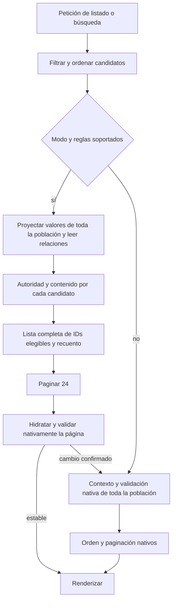

# Análisis del bloqueo de rendimiento y DAFO

Fecha: 2026-10-07. Corte de código `c68bcf8`, matriz `2f9f536`, documentos vigentes `ffaf1c0`. Análisis solicitado durante la pausa. No inicia carga, refactor, despliegue ni reanuda el goal. La cola única sigue en [docs/17](17-seguimiento-desarrollo.md). Las decisiones siguientes son propuestas para revisar antes de reanudar.

**Adopción posterior, 2026-10-07:** el usuario autoriza ajustar contrato y hoja de ruta para seguir esta solución. La dirección se adopta en [MOD-04, contrato 1.4](16-contrato-ejecucion-desarrollo.md#16-consolidación-del-rendimiento-de-lectura--mod-04), con secuencia/estado únicamente en [seguimiento17](17-seguimiento-desarrollo.md). Las referencias a «propuesta» de este análisis conservan su momento de elaboración; la implementación, la eficacia de cada intervención y el cierre siguen pendientes de evidencia. El goal continúa pausado.

## Conclusión

El servicio exige demasiado trabajo por listado/búsqueda para el presupuesto contractual. Reducir N+1 y sustituir cinco lecturas IN por ANY resolvió mecanismos concretos, pero la petición todavía recupera y evalúa la población completa de 10.000 candidatos antes de devolver24. La implementación mantiene coste SQL importante y miles de construcciones/validaciones Python. La repetición del fixture disimula parte del segundo coste.

Hay evidencia suficiente para abandonar una búsqueda genérica del «siguiente cuello». Dos frentes concretos requieren cierre conjunto: **compilación y ejecución de la consulta principal** y **trabajo de validación/materialización por candidato**. El bloqueo de atención concurrente es observable; la ubicación exacta de la espera anterior a WSGI no está instrumentada. No hay todavía una solución medida que cumpla el contrato.

La hipótesis SQL más precisa está en un plan ya obtenido:1.000 candidatos, ejecución4312,337ms, JIT4276,506ms, sin nodos paralelos. El siguiente diagnóstico causal debería aislar esa compilación. En paralelo conceptual, el diseño de lectura debe dejar de reconstruir objetos/formularios que no necesita para decidir elegibilidad. Resolver solo uno de los dos frentes no está sustentado como cierre.

## Contrato y resultado real

10.000 anuncios, 20 dinámicas/s durante 900 s, mezcla 1/3 listados, búsquedas y fichas ES/EN, uploads separados limitados; p95<800 ms y errores<1%. Se preservan elegibilidad, orden, recuento, páginas, vigencia y revocación. Los umbrales del generador y drain permanecen.

La última [carga corta](evidencias/listado-proyeccion-uuid-array-corta0110.json) fue válida y terminó **FAIL**:1.200 emitidas/0omitidas,60éxitos/1.140timeouts, p95 observable65,002574s;1.147 pendientes al cerrar60 s y 0 finales; upload 302. Generador p95/p99/max1,766/3,267/5,044ms. El p95 cercano a65 s refleja el límite del cliente y los timeouts; no significa que cada ejecución del backend dure65 s. El contractual anterior permanece **INVALID**; el FAIL corto anterior permanece. No habilita900 s ni acredita capacidad.

## Qué conecta graphify y qué confirma el código

Se consultaron los nodos de contrato, generador, pendientes y pausa, y las conexiones de `ProjectedPublication`. El mapa enlaza implementación, equivalencia, matriz y carga. `graphify path` no encontró un camino dirigido completo de `results()` a `.positive()`; por tanto el flujo siguiente se verificó directamente en las fuentes, no se dedujo de proximidad gráfica. El grafo es parcial y tiene referencias/aristas incompletas; las fuentes prevalecen.

Fuentes: [discovery.results](../apps/listings/discovery.py#L223), [ProjectedPublication](../apps/listings/projected_publication.py#L177), [projected_page](../apps/listings/projected_publication.py#L375), [PublicationContext](../apps/listings/public_validation.py#L169).

El recuento exacto se calcula después de la elegibilidad completa. Eso explica por qué una página de 24 sigue provocando trabajo sobre10.000. No autoriza paginar antes ni recortar candidatos. Un recorrido lineal no es por sí solo imposible a esta escala: el problema demostrado es cuánto trabajo pesado realiza por candidato y por request.

En `positive()` se construye una `Revision` por candidato y un `Rate` por tarifa **antes** de consultar el memo de contenido. Aunque Details/Contacts solo se validen una vez para entradas repetidas, esas construcciones siguen ocurriendo. La matriz cuenta10.025Revision y10.024Rate,20.292objetos en total, con solo24Listing hidratados. Son construcciones ORM, incluidas transitorias, no filas SQL retornadas ni entidades únicas.

## Correlación nueva de registros existentes

Se verificaron los SHA de `benchmark-worker-events.json` y `benchmark-samples.json` contra el informe congelado, y se cruzaron por ID. No se ejecutó otra carga ni se modificaron los registros. [Resultado derivado](evidencias/analisis-rendimiento-correlacion-existente0110.json) y [reconstructor](evidencias/reconstruir-correlacion-rendimiento0110.py).

Hay112dinámicas con entrada y final WSGI capturados, más1upload. Las112 se reparten en38listados,38búsquedas y36fichas. De ellas60fueron éxitos cliente y52timeouts. Para1.088emitidas no hay entrada WSGI capturada: no se les asigna ruta ni localización de espera.

| Población capturada | n | WSGI medio | WSGI p95 | SQL execute medio | CPU del hilo media | Emisión→entrada WSGI media |
| --- | ---: | ---: | ---: | ---: | ---: | ---: |
| Listado |38|7,878s|8,658s|4,642s|3,177s|55,624s|
| Búsqueda |38|5,258s|5,710s|2,038s|3,166s|57,110s|
| Ficha |36|0,095s|0,120s|0,047s|0,051s|58,457s|

Son cohortes seleccionadas por el progreso del servidor; no representan todos los requests. Las medias SQL, CPU y WSGI se solapan y no se suman como fases. CPU es `thread_time()` del hilo que sirve el request, incluida instrumentación; no CPU PostgreSQL ni de todo el proceso. Render medio de listado/búsqueda≈0,052s: no aparece como contribuyente principal en esa cohorte.

Cada PID permaneció dentro de WSGI entre59,893 y59,996s de la ventana de60,001513s. La unión observada cubre239,826 de 240,006worker-segundos disponibles:≈99,925%. Esto demuestra ocupación de las cuatro plazas de atención, no saturación de cuatro CPU. Dentro de WSGI también hay esperas.

48requests entraron en WSGI **después de que su cliente hubiera terminado por timeout**. Los52timeouts con final servidor capturado concluyeron en el servidor después del plazo cliente. Las fichas tardan≈95ms una vez dentro, pero esperan mucho antes de entrar: hay interferencia de los trabajos largos sobre las peticiones cortas en el servicio compartido. Identificar toda esa espera como «cola de Gunicorn» sería excesivo: el intervalo incluye conexión/envío cliente, TCP/backlog, aceptación y dispatch, que no están separados.

Relojes: `loop.time()` y `time.monotonic()` locales; cronología y deltas WSGI reconciliados. No hubo calibración independiente entre relojes. Algunos eventos servidor terminan hasta≈127,96s durante retirada de Gunicorn; no se convierten en éxito cliente ni amplían el drain del generador.

## Dimensión del desfase

Con cuatro workers sync y20 RPS, una condición necesaria de estabilidad es que el servicio medio de la mezcla sea inferior a4/20=0,2s, antes de reservar margen y uploads. Es un presupuesto de ocupación, distinto del p95<0,8s; no añade ni sustituye un gate contractual.

Si los tiempos medios observados de las tres familias se mantuvieran, la mezcla 1/3 requeriría≈4,410s de worker por petición, es decir≈88,2worker-segundos por segundo para20 RPS, frente a4disponibles. Aplicando el mismo cálculo a CPU del hilo,≈42,6CPU-segundos/s, frente a8CPU lógicas declaradas y compartidas. Es una estimación condicional de demanda, no capacidad medida ni recomendación de añadir workers/CPU; tiempos y contención pueden cambiar al optimizar.

Incluso sin concurrencia, las seis sondas previas ya daban4,053–5,679s para listado/búsqueda y0,124–0,236s para fichas. Una mejora marginal no basta. Si eliminar SQL dejase aproximadamente el trabajo CPU observado, seguiría fuera del presupuesto. Si solo se elimina construcción de formularios, la consulta principal seguiría siendo un riesgo independiente.

## SQL: mecanismo concreto pendiente

En la [matriz actual](evidencias/listado-proyeccion-uuid-array-matriz0110.json), una sola consulta principal concentra93,484% del tiempo SQL instrumentado de proyección contractual10.000:4,054659 de4,337267s. En1.000 concentra95,895%; en10.000 diverso92,694%. Son fracciones **del SQL de esas peticiones instrumentadas**, no del tiempo real sin profiler ni de la CPU PostgreSQL.

El EXPLAIN separado ya guardado para1.000 muestra:

- `Execution Time`:4312,337ms; `JIT Total`:4276,506ms;343funciones, inlining y optimización activos.
- Plan sin paralelismo; raízUnique1000filas/1loop, ancho estimado796bytes, coste total estimado614957,98.
- Tres subplanes para campos de la última verificación, cada uno con1000loops.
- Compartidos:17139hits y0reads en raíz, sin temp en ese plan. No prueba ausencia de otros costes ni representa filas escaneadas globales.

El cociente JIT/Execution del plan serial es≈99,17%; no es un porcentaje de CPU del request ni una predicción de ahorro. El plan previo10.000 diverso era paralelo y tenía JIT agregado7274,416ms frente aexecution4626,503ms: esos tiempos no se restan ni se trasladan a este plan.

PostgreSQL decide JIT según coste estimado; compilar puede costar más que ejecutar una consulta corta. Esto respalda una comprobación aislada, no un cambio global por intuición. [Documentación PostgreSQL17](https://www.postgresql.org/docs/17/jit-decision.html).

**Diagnóstico propuesto al reanudar:** misma lectura y parámetros en PG sintético, comparar configuración vigente con `SET LOCAL jit=off` dentro de transacciones propias, pocas parejas alternadas con orden registrado; separar SELECT cronometrado y EXPLAIN. Registrar ajustes efectivos, planning/JIT/ejecución, resultados equivalentes y control HTTP sin profiler. No cambiar el servidor compartido. La prueba decide si la compilación explica el suelo de varios segundos; un plan con JIT caro no garantiza que desactivarlo reduzca el request en igual cuantía.

Si se confirma, evaluar política JIT acotada a esa lectura o simplificación equivalente de la consulta. Revisar ancho/DISTINCT y repetición de última verificación con planes; no eliminar DISTINCT donde joins multiplican candidatos ni cambiar desempates silenciosamente. Los índices adicionales requieren coste residual demostrado; los planes ya usan índices en verificaciones y representación.

## Python y diversidad: el segundo frente

| Escenario10.000 | Control nativo sin profiler | Control proyección sin profiler | Details/Contacts en proyección |
| --- | ---: | ---: | --- |
| Fixture contractual repetido |13,858s|9,025s|1/1|
| Descripciones y contactos diversos |17,721s|22,903s|10000/10000|

Una muestra por modo, orden fijo y cachés compartidas: describe lo observado, no una mejora causal ni distribución. La proyección pierde su ventaja en la pareja diversa. El [diagnóstico controlado](evidencias/listado-proyeccion-checkpoint-sql-contenido0110.json) ya aisló descripciones/contactos y confirmó el coste de construir/copiar campos de formularios. En fixture repetido ese trabajo es pequeño; corregirlo solo para entradas únicas no basta para el FAIL contractual.

Existe además una incoherencia de diseño aprovechable: `PublicationContext._bound_validation()` comparte definiciones y crea bindings nuevos; `ProjectedPublication.native_content()` crea ModelForms completos por cada clave nueva. No se puede trasladar el mecanismo sin revisar estado mutable, normalización, errores y dependencias, pero el grafo y las fuentes muestran exactamente dónde se volvió a introducir esa construcción.

El perfil completo amplifica mucho los tiempos: proyección contractual28,079s frente acontrol9,025s; diverso135,259s frente a22,903s. La resta es diferencia observada, no overhead causal. Un umbral «SQL≥50% del request instrumentado» puede relegar SQL porque el profiler encarece Python. Ya tenemos pruebas SQL independientes; no debe usarse aquel porcentaje para descartar la consulta principal.

## Límite de consolidación del camino rápido

[`supported()`](../apps/listings/projected_publication.py#L159) retornaFalse cuando `settings.PRODUCTION`, hay filtros `checked` o promociones activas. Esto es deliberado para conservar semánticas aún no cubiertas. Significa que incluso un PASS del camino proyectado sintético no acredita esas rutas reales. No se propone quitar el guard.

Las reglas de publicación actuales viven entre formularios/modelos, validación de envío, comprobaciones de autoridad y prueba de contenido proyectada, con huella de implementaciones auditadas. Esa defensa detectó divergencias reales y debe conservarse; mantener varios intérpretes de las mismas reglas aumenta coste y fragilidad. Una solución consolidada necesita reglas comunes y alcance de ejecución explícito, no únicamente un caso sintético favorable.

## DAFO

| Dimensión | Hallazgo respaldado | Consecuencia para la decisión |
| --- | --- | --- |
| Fortalezas | Ledger reconciliable, generador válido, SHA y entornosPG propios; oracle nativo y negativas de revocación, helpers/wrappers y paginación; rutas observadas. | Permiten cambiar implementación con comparación funcional y conservar veredictos históricos. |
| Debilidades | Trabajo completo por candidato; objetos transitorios antes del memo; consulta ancha con compilación cara; ruta diversa reconstruye ModelForms; camino rápido excluido en PRODUCTION/checked/promociones. | Una microoptimización aislada no constituye una solución general ni demuestra capacidad. |
| Debilidades del proceso | Muchos ciclos de optimización local, perfiles invasivos, una muestra y ruido compartido; controles ya muy superiores al presupuesto; documentación mezcla cronología extensa con decisiones vigentes. | Los tests verdes no deben confundirse con viabilidad de rendimiento; faltaba conectar coste/request con20 RPS y4 workers. |
| Oportunidades | Reutilizar registros para atribuir ocupación; experimento causal JIT pequeño; lectura SQL estrecha y reglas comunes sobre valores; reutilizar definiciones de formularios, construir solo en misses comprobados. | Atacar mecanismos de gran alcance, con hipótesis finitas y sin repetir900 s ni abrir otra cola. |
| Amenazas | Revocaciones/expiraciones/normalización y count exacto; diversidad, historiales y filtros poco representados en el fixture; observación parcial y overhead; trabajo servidor después de timeout. | Evitar falsosPASS por fixture, caché obsoleta, paginación anticipada, atribución falsa o simple aumento de workers. |

Cruce DAFO: usar las fortalezas de equivalencia para simplificar el camino de lectura; usar evidencia JIT/CPU para ordenar el trabajo; cerrar las debilidades de medición con controles focalizados; contener amenazas con autoridad actual, count/páginas nativos y datos diversos. El DAFO ordena decisiones, no añade mediciones.

## Solución candidata que puede consolidar el bloque

**Una ruta de lectura de publicación con reglas compartidas y costes acotados**, combinada con una consulta principal cuyo coste de compilación y ejecución esté controlado. No está implementada ni se garantiza su rendimiento.

1. **Autoridad actual:** evaluar estado, caducidad, representación, consentimiento, versión documental, comprobaciones, restricciones y revocaciones sobre datos actuales. Predicados equivalentes en SQL donde sea posible; compartir su definición con la ruta nativa. «Aprobado antes» no acredita elegibilidad ahora.
2. **Contenido con una fuente de reglas:** extraer gradualmente reglas comunes de los formularios a validadores explícitos de valores; los formularios de escritura y la lectura usan las mismas reglas. Mantener conversión, normalización, validación de campos/modelo, errores y dependencias. Una implementación SQL de una regla necesita equivalencia específica; no trasladar regex/NULL/listas por intuición.
3. **Trabajo pesado bajo demanda:** no crear `Rate`/formularios antes de saber que la evaluación los necesita. `Revision` participa hoy en validación de título/modelo: reducir su creación exige demostrar dependencia y equivalencia; no sustituirla a ciegas por diccionario. Compartir definiciones, no estado mutable ni autoridad entre peticiones. Ninguna caché nueva de elegibilidad.
4. **Recuento y páginas:** mantener primero el conjunto elegible exacto. Si todas las reglas necesarias quedan expresadas de forma equivalente en consulta, count/orden/página pueden resolverse allí; mientras haya residuales, evaluarlos sobre valores de toda la población y contabilizarlos. No limitar24 antes de completar elegibilidad. La hidratación completa sí se mantiene en la página seleccionada con guard de vigencia.
5. **Cobertura operativa:** diseñar la misma estrategia para modo PRODUCTION,checked y promociones, preservando ranking y comprobaciones reales. Hasta demostrarla, esas rutas conservan fallback y el alcance de aceptación sigue limitado. No integrar proveedores externos ni presentar fixtures sintéticos como verificaciones reales.

El camino incremental más corto es confirmar JIT y retirar construcciones/copias innecesarias en el mecanismo demostrado. Si con ello el coste sigue lejos del presupuesto, no encadenar más cachés pequeñas: completar la separación de reglas y representación. Una certificación persistida de contenido exigiría inmutabilidad/versionado e invalidación demostrados y sería otro diseño; no se adopta como parche en este análisis.

## Protocolo de decisión para salir del ciclo

Cuando se reanude, una sola entrega: reducir el coste del listado preservando semántica. HipótesisSQL y Python explícitas, fuente/base y salida prefijadas. Cada piloto debe informar ganancia absoluta por request sin profiler y mecanismo corregido; una ganancia en un microbenchmark no basta.

- **JIT:** comparación aislada descrita; si no reduce el coste relevante, descartar esa intervención, conservar evidencia y revisar el plan residual. No cambiar umbrales de carga.
- **Python:** construcción bajo demanda/definiciones comunes con control repetido y único; comparar objetos, validaciones, SQL y request con instrumentos equivalentes. Preservar negativos PK fuera de primera página, helpers/wrappers, cardinalidades, última página, revocación y cambios de catálogo/documento.
- **Viabilidad:** contrastar controles sin profiler y demanda media de servicio con el presupuesto de 4 workers/20 RPS. Una media insuficiente impide prometer capacidad aunque un p95 aislado parezca favorable. No convertir esta estimación en PASS contractual.
- **Aceptación:** equivalencia funcional pertinente → matriz100/1000/10000 con controles y diversidad → corta20 RPS durante 60 s vigente →900 s únicamente con PASS completo. Reutilizar negativos y mediciones equivalentes cuando sus fuentes/dependencias lo permitan; no acumular baterías innecesarias.

La corta mantiene escenario/generador/contabilidad válidos,0noemitidas,demora p95≤10/p99≤25/max≤100ms,timeout65 s,drain≤70 s,pendientesventana≤20/final0,p95observable<800 ms,errores<1% yuploads conformes. FAIL/INVALID bloquean900 s. El contractual mantiene10.000/20 RPS/900 s y15uploads separados. No se aumenta avance65,38%/CR09 72,50%, ni se declara cierre, a partir de este análisis.

## Fuentes y límites

Las cifras de carga se derivan de la última fuente `c68bcf8`; perfiles/planes se identifican por su propia fuente. No se combinan en un ensayo ni se atribuye causalidad a diferencias históricas. Matriz retiene control nativo1000de 350,422714s, causa not_measured. Conservamos la distinción entre SQLexecute, filas por nodo EXPLAIN, objetos ORM, eventos internos, CPU del hilo y latencia cliente. DB CPU/RSS/waits/locks/IO y cola exacta no se rellenan por inferencia.

[Marco acordado](criterios-revision-benchmark-carga.md), [matriz actual](evidencias/listado-proyeccion-uuid-array-matriz0110.json), [equivalencia actual](evidencias/listado-proyeccion-uuid-array-funcional0110.json), [diversidad y SQL](evidencias/listado-proyeccion-checkpoint-sql-contenido0110.json), [corta actual](evidencias/listado-proyeccion-uuid-array-corta0110.json), [correlación derivada](evidencias/analisis-rendimiento-correlacion-existente0110.json). El análisis no afirma mejora backend por corrección del generador y no cambia el INVALID/FAIL anteriores.
