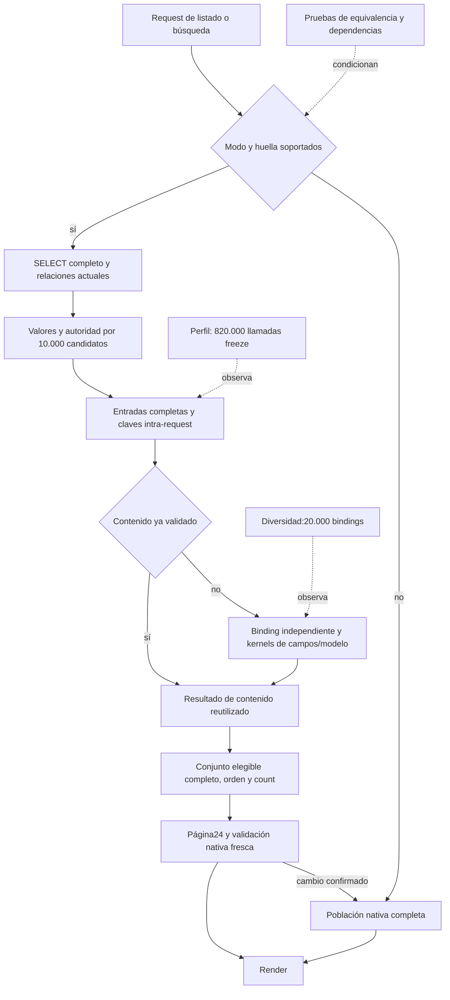

# Análisis del bloqueo de rendimiento y DAFO — segunda pausa

Fecha: 2026-10-07. Fuente de aplicación analizada: `b285aba`. **Goal automático pausado por petición del usuario.** La segunda pausa incorporó pruebas existentes y el diagnóstico que ya estaba en curso. Después, el usuario encargó atender directamente la investigación con calma y profundidad: se añadió un único contraste operativo manual, ya terminal y revisado, sin modificar backend ni iniciar carga. La cola única permanece en [seguimiento17](17-seguimiento-desarrollo.md). Contrato 1.4/MOD-04 y umbrales sin cambios.

El [primer análisis conservado íntegro](17-historial/2026-10-07-analisis-dafo-primer-corte.md), adoptado desde `dcc0179`, describía código y resultados anteriores a estas intervenciones. SHA de esa copia: `413e826f24b92a923eb0aa466794baf5fb1809ff782c42a5ed21ed58296dd920`. Sus propuestas y tiempos mantienen su contexto histórico; las conclusiones vigentes son las de este documento. Los enlaces relativos de la copia histórica conservan la base original `docs/`.

## Conclusión actual

**Seguimos bloqueados en la viabilidad del coste por petición, pero ya no exactamente en los mismos mecanismos.** La construcción masiva de modelos y de definiciones de formularios se ha reducido dentro del alcance observado, y la política JIT se ha acotado con pruebas. El contraste operativo manual más reciente obtiene medianas sin profiler de **3,325161 s con contenido repetido y 8,325591 s con contenido diverso**, cuatro muestras por variante de `/es/` y 10.000 candidatos. Son tiempos DjangoClient, no latencias concurrentes ni un PASS/FAIL contractual nuevo. El backend no cambió: las diferencias frente a controles anteriores no son una mejora implementada.

La lectura conserva una cadena extensa por candidato: recuperar valores completos, preparar estructuras, construir claves recursivas, comprobar autoridad y, en contenido distinto, crear bindings y recorrer limpieza de campos/formulario/modelo. El ahorro en objetos no elimina esa cadena. La memoización evita repetir algunas validaciones, pero también realiza trabajo para reconocer cada coincidencia.

El perfil final identifica **820.000 llamadas a `freeze` en cada escenario**, incluso cuando Details y Contacts solo se validan una vez. Sus exclusivos instrumentados rondan 10,6–10,8 s y superan el request completo sin profiler. El nuevo replay separado, con entradas completas capturadas y sin profiler, mide **0,477824/1,677366 s** para claves, búsquedas y contadores. Es trabajo relevante y cumple el criterio previo para justificar como máximo un piloto; no es una medición exclusiva de `freeze` dentro del HTTP ni un ahorro disponible. La preparación completa ronda dos segundos y la evaluación del conjunto diverso ronda 5,7 s en los relojes agregados: las claves por sí solas no acreditan una solución.

La solución adoptada —reglas compartidas sobre valores y lectura con coste controlado— sigue siendo una dirección razonable, pero está **parcialmente realizada**. Los nuevos kernels aún se apoyan en bindings y métodos internos de ModelForm y requieren ampliar una huella finita. La prioridad debe pasar de perseguir el siguiente nombre del profiler a demostrar el coste de una ruta completa, con una condición de salida que pueda descartar la estrategia. No hay evidencia para prometer que una optimización de claves, SQL o formularios por separado cierre la diferencia.

## Qué se añadió desde el primer razonamiento

[Derivación reproducible](evidencias/analisis-rendimiento-segunda-pausa0110.json), generada por [este lector de evidencias](evidencias/reconstruir-analisis-segunda-pausa0110.py). Comprueba aritmética y registra SHA de los informes; no ejecuta tests ni SQL. Las suites siguientes se solapan y pertenecen a fuentes distintas: **no se suman como una N2 común**.

| Cambio o contraste | Pruebas y fuente | Qué demuestra y límite |
| --- | --- | --- |
| JIT, replay de SELECT | `91e0834`, 2 PG; [contraste](evidencias/listado-proyeccion-jit-contraste0110.json) | Resultado no concluyente: lecturas pareadas no reprodujeron el ahorro sugerido por EXPLAIN. Se conserva esa conclusión. |
| JIT, contexto HTTP | `fb2d213`, 1 PG con cuatro tripletas; [contraste](evidencias/listado-proyeccion-http-jit-contexto0110.json) | Medianas C/JIT-on 7,312985 s y B/JIT-off 3,403556 s, ambos instrumentados y en transacción equivalente; diferencia emparejada mediana 3,955016 s. Confirma efecto en esa fase, no ahorro transferible a los controles anteriores ni capacidad. |
| Política JIT local | `1abc6e7`, 22 PG; [N1](evidencias/listado-proyeccion-jit-scope-n1-0110.json) | Solo SELECT escalar; restaura ajuste on/off, transacción exterior escribible y recuperación tras error. No ajuste global de PostgreSQL. |
| Construcción diferida y bindings independientes | `a65ee1e`, 27 PG; [N1](evidencias/listado-proyeccion-bindings-n1-0110.json) | Repetidos100: 2 Revision/2 Rate antes de hidratar página. Únicos50 con inválido fuera de página: 49 elegibles, orden/count/páginas ES/EN y errores independientes. Construcciones, no filas SQL. |
| Reglas de Details compartidas y limpieza de campos reutilizada | `aa9f6bd`, 31 PG; [N1](evidencias/listado-proyeccion-valores-n1-0110.json) | Oráculo congelado del clean anterior, diez variantes por idioma, datos limpios y errores iguales. Hits/misses reconciliados; no tiempo ahorrado deducido de hits. |
| Kernel de campos de modelo sobre valores | `e0eea09`, 35 PG; [N1](evidencias/listado-proyeccion-kernel-valores-n1-0110.json) | Oráculos Details/Contacts, exclusiones/defaults y reglas de modelo auditadas; elimina construcción por contenido único en el dominio probado. Rate y casos no cubiertos siguen nativos. |
| Kernel de entrada, widgets y liberación de callbacks | `71823ba`, 37 PG; [N1](evidencias/listado-proyeccion-input-kernel-n1-0110.json) | Extracción/normalización y errores equivalentes; omisiones/disabled y bindings especiales conservan tratamiento nativo. Negativas PK, helpers, wrappers y revocación incluidas. Seis unidades adicionales se registraron separadamente, no como parte de esa suite PG. |
| Asignación semántica omitida por el kernel | Unidad específica; [evidencia](evidencias/listado-proyeccion-kernel-asignacion-unit0110.json) | `save_form_data` con wraps transforma Telegram: la vía privada sin guard diverge. Se añade a huella y la vía soportada lo rechaza. Prueba unitaria, no reproducción PostgreSQL de ese wrapper ni cobertura universal. |
| Clave semántica fuera de huella | `7b5fef6`, 1 PG; [evidencia](evidencias/listado-proyeccion-freeze-boundary0110.json) | Wrapper de `freeze` colapsa claves: bypass privado acepta50 frente a49 nativos; inválido en índice25, fuera de primera página. Tras guard, vía pública fallback conserva49 y páginas1/2/3 ES/EN. No confundir bypass deliberado con fallo público posterior a la corrección. |
| Corrección del observador de reglas | Unidades y `3f67369`, 2 PG; [cuerpos individuales](evidencias/listado-proyeccion-cuerpos-texto0110.json) | Se detectó código compartido entre wrappers de texto/Telegram. El observador rechaza etiquetas ambiguas y mide cuerpos distintos. Las métricas individuales ausentes del perfil anterior permanecen `not_measured`; no se rellenan retrospectivamente. |
| Perfil final de entrada, lectura y claves | `b285aba`, 2 PG; [informe revisado](evidencias/listado-proyeccion-input-kernel-perfil0110.json) | Terminal correcto: pytest384,58 s, etapa del ejecutor387,975 s. SHA, fuentes intactas, aritmética, ausencia independiente de bases y retirada de medios verificados. Ambos modos y controles tienen cuerpo/count/ruta equivalentes. R3/N2, matriz nueva y capacidad siguen pendientes. |
| Contraste operativo manual posterior | Aplicación `b285aba` más test y documentos congelados por SHA, 2 PG; [informe revisado](evidencias/listado-proyeccion-operacional0110.json) | Cuatro parejas con/sin observación agregada por variante y replay separado de claves reales. Pytest249,88 s, etapa del ejecutor251,937 s; terminal, fuentes, artefactos, aritmética y retirada independiente comprobados. Cambiaron estadísticas PG durante el escenario repetido: limita causalidad; no se repite la prueba para ocultar ese resultado. |

Los tests funcionales prueban mecanismos y contratos concretos. No acreditan por acumulación todas las rutas del producto ni rendimiento concurrente. Desde el análisis anterior hay24 commits hasta `b285aba`; ese número describe actividad, no avance aceptado.

## Evolución observada del tiempo absoluto

Todos estos controles son de10.000 candidatos y del listado `/es/`. Una muestra por modo y ejecución, orden fijo y cachés compartidas/calientes; los distintos momentos/fuentes impiden una atribución causal histórica. Se presentan para ver dónde seguimos, sin porcentajes de mejora ni resta de profiler como corrección.

| Fuente / etapa | Proyectado repetido | Proyectado diverso |
| --- | ---: | ---: |
| `2f9f536` — Antes de MOD-04 | 9,024714 s | 22,902557 s |
| `4fff302` — Bindings y construcción diferida | 9,084404 s | 15,951735 s |
| `cb3ceab` — JIT acotado, controles | 4,059435 s | 13,392995 s |
| `6241f1e` — Reglas compartidas, controles | 4,273722 s | 13,120266 s |
| `c76afd2` — Reglas compartidas, perfil | 4,384290 s | 12,041706 s |
| `cbd708c` — Kernel de modelo, controles | 4,042215 s | 9,477784 s |
| `d74d70d` — Kernel de modelo, perfil | 2,912375 s | 9,362006 s |
| `5277580` — Kernel de entrada, controles | 4,067710 s | 8,663979 s |
| `b285aba` — Perfil final de entrada/lectura/claves | 4,732711 s | 8,354710 s |

Los controles recientes del escenario repetido oscilan aproximadamente entre2,91 y4,73 s; no se ha establecido una tendencia fiable tras cada edición. En diverso se observan duraciones menores que en el primer análisis, y las construcciones directamente contadas también han cambiado, pero no existe un A/B entre versiones que cuantifique cuánto aporta cada cambio. Decir «nada ha cambiado» sería incorrecto; decir «el bloqueo está casi resuelto» tampoco está sustentado.

La última matriz completa100/1.000/10.000 sigue siendo la de `2f9f536`; incluye el control nativo1000 de350,422714 s, conservado con causa desconocida. No se rellenan sus celdas con valores de las nuevas fuentes ni se presenta como matriz del código actual.

## Qué explica ahora el perfil y qué no explica

El [perfil final](evidencias/listado-proyeccion-input-kernel-perfil0110.json) usa iguales targets en native/projected, `sys.setprofile` sin envolver reglas, wrapperSQL y señales de construcción. La ruta proyectada tiene10.000 positivos,0fallback y24 filas de página hidratadas en ambos escenarios. El modo native está forzado deliberadamente a fallback para comparar. La medición de ruta prueba qué recorrido se observó; no demuestra seguridad completa de la huella.

| Métrica de la proyección | Repetido | Diverso | Interpretación |
| --- | ---: | ---: | --- |
| Request sin profiler |4,732711 s|8,354710 s|DjangoClient, sin red/Gunicorn ni concurrencia.|
| Request con instrumentos |23,018307 s|45,230674 s|Otra petición, con fuerte perturbación; overhead causal `not_measured`.|
| Queries / SQL execute acumulado |91 / 0,725844 s|91 / 0,680148 s|Driver/ejecución/esperas correspondientes al método; excluye fetch explícito. No CPU PostgreSQL.|
| Construcciones de modelos |295|295|Listing24, Revision26, Rate26 en ambos. Total por señales; no filas SQL ni entidades únicas.|
| BaseModelForm.__init__ |7 llamadas|7 llamadas|Ya no reaparece el antiguo constructor completo por contenido único.|
| Details / Contacts / Rate de contenido |1 / 1 / 2|10.000 / 10.000 / 2|La diversidad altera descripciones/Telegram, manteniendo las demás cardinalidades del fixture.|
| `freeze` |820.000 llamadas|820.000 llamadas|82 eventos por candidato en este fixture; incluye recursión.|
| `freeze` exclusivo instrumentado |10,625497 s|10,813802 s|Incluye trabajo de observación en el alcance; no contribución sin profiler ni ahorro.|
| Kernel de entrada calls / exclusivo |2 / 0,000872 s|20.000 / 5,520566 s|Validación directamente observada. No deducida de total−SQL.|
| Kernel de modelo calls / exclusivo |2 / 0,000302 s|20.000 / 2,863465 s|Campos nativos sobre valores bajo reglas auditadas.|
| Binding calls / exclusivo |52 / 0,006549 s|20.050 / 3,469120 s|Descuenta full_clean observado; no se suma a sus inclusivos.|
| Lectura escalar inclusiva |3,071292 s|3,175765 s|Contiene ValuesIterable, SQL lazy y otros trabajos anidados.|
| ValuesIterable segmentos / inclusivo |10.001 / 2,967242 s|10.001 / 3,054524 s|Eventos call/return alrededor de yields. No rows_returned ni tiempo puro de decodificación.|
| Render inclusivo |0,272713 s|0,251113 s|Contiene hijos ORM/lazy; no comparable directamente al render de una carga anterior.|

El JSON conserva por regla calls, inclusive/exclusive, mean/max exclusive e hijos descontados; p95 por regla `not_measured`. El exclusivo descuenta solo hijos instrumentados directos una vez. La recursión de `freeze` da inclusivos acumulados21,797118/22,073210 s: no añadirlos a los exclusivos ni al padre. SQL lazy puede ocurrir dentro de lectura, validación o render y no se descuenta como un hijo del profiler Python. Ninguna de estas filas forma una partición sumable del request.

Tres conclusiones concretas:

1. **El repetido ya casi no ejecuta los kernels de contenido, pero sigue siendo lento.** Optimizar únicamente la validación de descripciones únicas no puede explicar el cierre de ese escenario. Preparación de entradas, claves, autoridad y lectura completa siguen presentes en cada candidato.
2. **El diverso sigue ejecutando20.000 bindings de Details/Contacts.** Compartir definiciones y reducir modelos no ha convertido aún esa ruta en un evaluador directo de valores. La diferencia de tiempos entre fixtures no se atribuye íntegramente a esos bindings; se conocen sus llamadas y eventos propios, no una descomposición causal del control.
3. **La clave era una hipótesis precisa que el contraste posterior acota.** El esquema prepara `tuple(data.items())`, congela recursivamente nombres, valores y contenedores, y lo hace también en los hits. El replay posterior mide ese mecanismo fuera del request, con los límites descritos abajo. Cambiarlo necesita conservar distinción de tipos, listas/tuplas, orden, multiplicidad y entradas desconocidas, además de toda dependencia semántica.

## Contraste operativo manual: resultado y decisión

[Manifiesto prefijado](evidencias/listado-proyeccion-operacional-manifiesto0110.json), [test ejecutado](../tests/test_projection_operational_attribution.py) e [informe revisado con fuentes y muestras](evidencias/listado-proyeccion-operacional0110.json). PostgreSQL sintético propio; escenario repetido original y diversidad de descripciones/Telegram, 10.000 candidatos cada uno. «Contractual» en la etiqueta del fixture identifica los datos: **no se ejecutaron los 900 s ni la prueba corta**.

Por variante: oráculo nativo fuera de los tiempos, warmup explícito y cuatro parejas AB/BA/AB/BA; A solo reloj exterior, B relojes de preparación/conjunto/render y SQL execute. Sin `sys.setprofile`, señales de construcción ni sustitución de reglas. Huella y soporte iguales antes/después; cuerpo, count, página inicial y ruta coinciden, 10.000 positivos/0fallback. El SHA de IDs ordenados completos se compara entre muestras B; este test **no** compara todos los IDs nativos ni todas las páginas. Las equivalencias más amplias conservan sus fuentes previas y R3 sigue pendiente.

| Mediana observada, segundos | Repetido | Diverso | Alcance |
| --- | ---: | ---: | --- |
| GET sin observación interna, 4 muestras |3,325161|8,325591|Tiempo exterior DjangoClient; sin red/Gunicorn.|
| GET con observación agregada, 4 muestras |3,620498|8,061461|Otra petición; incluye coste de sus instrumentos.|
| Diferencia emparejada B−A |0,268941|−0,264129|Pasa el criterio previo de compatibilidad en ambos; no overhead causal.|
| Preparación de proyección |2,124684|1,911432|SELECT, evaluación ORM, mapas, relaciones, catálogo y definiciones.|
| Evaluación del conjunto elegible |1,187425|5,709273|Autoridad, entradas/claves, reglas, posibles fallbacks y colección ordenada. No validación pura.|
| Render |0,051890|0,083908|Puede contener evaluación lazy y SQL.|
| SQL execute acumulado, 91 calls en cada B |0,917780|0,750115|Anidado en las etapas; no sumarlo ni llamarlo CPU PG.|
| Replay separado de 30.000 claves, 4 muestras |0,477824|1,677366|Claves completas, lookup/store y contadores; excluye SQL, formas y validadores.|

Las medianas de intervalos distintos no forman una descomposición sumable. Los patrones SQL normalizados conservan calls/total/mean por petición en el JSON, sin parámetros ni valores sensibles. Este contraste no midió filas SQL, objetos construidos ni reglas individuales; reutiliza el perfil anterior para esas métricas dentro de su alcance, sin trasplantarlas a las peticiones nuevas.

El replay usa una captura separada no cronometrada, con 30.000 llamadas a `native_content` y entradas completas reales: 10.000 por familia, idioma y catálogo del request. Mantenerlas vivas altera memoria/GC y por eso la captura no es un control de latencia. Cada replay crea memos nuevos y reconcilia hits+misses=10.000 por familia. Misses Details/Contacts/Rate: **1/1/2** repetido y **10.000/10.000/2** diverso; cero hits en las dos familias únicas se representa como clave ausente en el contador, no como métrica ausente. No se exportan valores capturados. El tiempo del replay no se resta del HTTP ni se usa como cota exacta del ahorro.

**Confusor demostrado:** las estadísticas observadas de cinco relaciones pasaron de estimaciones desconocidas (`reltuples=-1`, páginas0) a estimaciones de10.002 filas durante las parejas repetidas. El cambio se detecta entre endpoints; su instante y causa —incluido un posible autoanálisis— son `not_measured`. En diverso, esos endpoints fueron iguales, lo que tampoco garantiza que todo el servidor permaneciera estable. Se conserva la observación completa. La diferencia negativa B−A del diverso no significa que observar acelere la aplicación. La compatibilidad numérica prefijada se cumple, pero no acredita un overhead causal bajo.

**Decisión cerrada de este contraste:** hay coste operativo de reconocimiento/reutilización suficiente para permitir un piloto de claves según el umbral anterior (≥0,25 s y ≥10% del control), pero no evidencia para priorizarlo como solución aislada. Preparación y evaluación de datos diversos siguen siendo frentes distintos. No se implementa otra microoptimización ni se repite un perfil global para volver a ordenar funciones. Se concreta debajo el diseño de la ruta completa y las dependencias que debe cubrir. No cambia ningún umbral después de ver resultados.

Para una futura comparación causal entre implementaciones, preparar y registrar estadísticas de las relaciones propias antes del warmup, fijar el estado inicial y comprobarlo al finalizar; una variación relevante obliga a declarar el contraste no concluyente en su alcance. Esto es preparación del siguiente experimento, no un ajuste del servidor compartido ni una reinterpretación del ensayo actual. No repetir estos controles sin candidato o incertidumbre nueva.

### SQL residual y lectura de valores

Las cinco consultas dominantes de cada perfil están normalizadas, con calls/total/mean completos en la [derivación](evidencias/analisis-rendimiento-segunda-pausa0110.json). Parámetros y literales sensibles redactados.

| Lectura/grupo | Repetido: calls / total s / mean s | Diverso: calls / total s / mean s |
| --- | --- | --- |
| SELECT escalar principal |1 / 0,428901 / 0,428901|1 / 0,369688 / 0,369688|
| Fotos y estado de blob de población |1 / 0,050520 / 0,050520|1 / 0,041197 / 0,041197|
| Consultas de fotos de página |24 / 0,038800 / 0,001617|24 / 0,036394 / 0,001516|
| Categorías de población, entre top5 repetido |1 / 0,035502 / 0,035502|Fuera de top5; capturado en informe completo.|
| Última verificación de página, entre top5 repetido |24 / 0,028982 / 0,001208|Fuera de top5; capturado en informe completo.|
| Servicios de población, entre top5 diverso |Fuera de top5; capturado en informe completo.|1 / 0,042804 / 0,042804|
| Hidratación de página, entre top5 diverso |Fuera de top5; capturado en informe completo.|1 / 0,034745 / 0,034745|

Top5 concentra80,28%/77,16% del SQL observado. Son porcentajes descriptivos de SQL, no avance ni mejora. Las24 consultas por grupo dependen de la página24; no confundirlas con volver al N+1 de10.000 ni establecer un límite arbitrario de queries. Tampoco quedan justificadas solo por ser de página: se priorizan por coste y riesgo medidos.

La fuente sigue seleccionando todos los campos concretos de Revision y Person. `positive()` prepara el diccionario completo de Revision por candidato aunque el objeto sea lazy. Esto fundamenta revisar dependencias/representación; **no mide** bytes transferidos, coste de esas columnas, CPU de decodificación o beneficio de suprimirlas. ValuesIterable contiene varios mecanismos y su tiempo no permite separarlos.

Los EXPLAIN anteriores de las3–5 lecturas y los contrastes JIT se reutilizan dentro de su fuente. No se ejecutó otro EXPLAIN en esta pausa ni hubo uno nuevo en el perfil final, cuyo criterio de captura no se activó. El porcentajeSQL dentro de un perfil Python muy invasivo no permite descartar SQL. Si una próxima medición ligera lo identifica como dominante, los planes se obtendrán por separado sobre lecturas del PG sintético propio, conservando joins/DISTINCT/desempates. No se declara necesario un índice, cambio de servidor o caché.

## Conexiones del grafo comprobadas en código

El mapa anterior conservaba AST previo a los kernels. En esta revisión se reextrae el código acotado y se añaden evidencia y conclusiones con procedencia. Se conserva una copia previa; el resto del grafo mantiene su carácter histórico. La proximidad entre nodos no se usa como prueba causal.

Fuentes: `discovery.results`, `projected_page`, `ProjectedPublication.__init__/positive/native_content/visible_ids` y `public_validation.validate_publication_binding` en el corte `b285aba`. La huella se comprueba antes y después del conjunto. La revisión de página ante cambio confirmado puede recomputar la población nativa. READ COMMITTED y estos guards no se presentan como una fotografía atómica de todo el conjunto.

La conexión decisiva es **count exacto → elegibilidad completa → trabajo por candidato → ocupación por petición**. Conservar count no obliga a crear formularios ni a congelar de nuevo todo el esquema; sí exige no descartar candidatos antes de conocer su elegibilidad. Un recorrido O(N) de10.000 valores no demuestra inviabilidad por sí mismo: importan los costes del trabajo que lleva dentro y la consulta que lo alimenta.

## Por qué el proceso volvió a atascarse

- **Se retiraron componentes caros sin cerrar el recorrido completo.** Pasamos de construir modelos/formularios a copiar bindings, preparar entradas y validar mediante kernels. Reducir objetos era necesario según la evidencia anterior, pero no era una definición suficiente de terminado.
- **El éxito funcional condicionó el siguiente microciclo, sin demostrar una trayectoria de coste.** La equivalencia habilita medir; no prueba viabilidad. Las fuentes tienen controles absolutos útiles, pero una muestra fija por modo no decide causalmente pequeñas diferencias entre versiones.
- **La observación es demasiado invasiva para ordenar algunos trabajos pequeños.** Añadir un target de820.000 llamadas altera considerablemente la descomposición. Además, se corrigió un defecto real de etiquetas compartidas. Que el tiempo exclusivo sea aritméticamente consistente no garantiza representatividad sin profiler.
- **La frontera semántica crece al mantener una segunda ejecución de partes de ModelForm.** Las lagunas de `save_form_data` y `freeze` requirieron nuevas pruebas. Están reparadas en su alcance, pero cada bypass obliga a volver a razonar sobre dependencias y evita tratar la huella como certificado universal.
- **R3 y R4 quedan detrás de una R2 abierta sin demostración conjunta.** La matriz actual de tamaños y los costes de PRODUCTION/checked/promociones faltan. Un camino sintético más rápido no resolvería por sí solo esas rutas.
- **El seguimiento mezclaba instrucciones actuales e hitos pasados.** Se conserva íntegro el estado previo en historial y se sustituye su cabecera operativa por el estado pausado y la decisión pendiente, sin otra cola.

Esto no invalida las pruebas anteriores. Indica que la unidad de decisión debe ser una implementación de lectura completa y su viabilidad, como ya exigía MOD-04, en lugar de convertir cada función optimizada en un paso indefinido hacia el cierre.

## DAFO actualizado

| Dimensión | Evidencia actual | Implicación |
| --- | --- | --- |
| Fortalezas | Oráculos nativos, normalización/errores ES/EN, negativas fuera de página, revocación concurrente, PG aislado, fuentes congeladas y contabilidad de carga. | Base suficiente para ensayar una simplificación de diseño sin relajar elegibilidad ni reconstruir toda la auditoría. |
| Fortalezas | Materialización bajo demanda comprobada; 295 construcciones y7 ModelForms en ambas variantes del último perfil. JIT local con restauración probada. | Estos mecanismos no se vuelven a diagnosticar como si continuaran intactos; se reutiliza la evidencia en su alcance. |
| Fortalezas | Contraste manual con cuatro parejas y replay reconciliado de entradas reales, sin profiler global. | La investigación de claves ya tiene una respuesta acotada; conservar muestras y limitaciones evita volver a partir del ranking invasivo. |
| Debilidades | Se sigue preparando y evaluando toda la población;820.000 llamadas de clave;20.000 bindings en diverso; lectura escalar ancha. | La ruta tiene costes de preparación y validación aun con pocos modelos. Priorizar una representación/contrato de reglas explícito. |
| Debilidades | Huella finita y kernels ligados a métodos internos; cobertura y coste de modos excluidos pendientes. | Más parches de huella no equivalen a consolidación arquitectónica ni a aceptación de producción. |
| Debilidades del proceso | Perfiles invasivos e históricos con una muestra; el contraste nuevo mejora la observación pero descubre estadísticas PG cambiantes. R2 sigue prolongada. | Compatibilidad del observador y efecto causal son distintos; estabilizar y registrar el escenario antes de comparar un candidato, sin repetir por rutina. |
| Oportunidades | El patrón repetido separa trabajo común de misses; el diverso revela20.000 evaluaciones; ya conocemos los oráculos y dependencias relevantes. | Preparar esquema/definiciones una vez y procesar valores con reglas compartidas, midiendo tanto hits como misses. |
| Oportunidades | Grafo actualizado conecta dato → regla → guard → prueba → evidencia → gate. | Revisar dependencias omitidas y distinguir coste observado, hipótesis y aceptación pendiente. |
| Amenazas | Revocaciones, documento/catálogo, tipos/normalización, orden/count, PK y wrappers semánticos. | No sustituir clave completa por identidad aparente ni adelantar paginación; desconocidos permanecen nativos. |
| Amenazas | Fixture repetido, rutas excluidas, estadísticas cambiantes, SQL/esperas no separados y controles fuera de Gunicorn. | Un piloto favorable puede no transferirse a la mezcla. Evitar prometer20RPS, sumar tiempos solapados o escalar como parche. |

Cruce DAFO: **fortalezas–oportunidades**, usar oráculos y datos diversos para simplificar la ruta completa; **debilidades–oportunidades**, usar el contraste operativo ya obtenido para abordar preparación y evaluación diversa juntas; **fortalezas–amenazas**, conservar autoridad fresca y negativas fuera de página; **debilidades–amenazas**, exigir efecto del candidato completo y reconocer confusores, evitando acumular éxitos locales que no cambian la viabilidad.

## Solución que merece contrastarse

Se propone completar, dentro de MOD-04, una **ruta explícita de validación de publicación sobre valores actuales**, con adaptadores para formularios de escritura y lectura. No se propone persistir elegibilidad, omitir reglas ni migrar por intuición toda la lógica a SQL. Es una dirección revisada, no implementación ni mejora medida.

- Preparar una vez por request el esquema y las definiciones auditadas. La clave de reutilización debe mantener kind/clase de regla, versión/definición de esquema, idioma, catálogo fresco y todas las entradas tipadas de esa evaluación. Un esquema fijo puede evitar recorrer nombres constantes; hay que demostrar esa equivalencia antes de sustituir `freeze`. No añadir otra caché.
- Compartir normalización, campos y reglas de contenido de forma explícita. La escritura sigue exponiendo los mismos errores y efectos. Los kernels actuales y el oráculo congelado son material reutilizable, pero sustituir callbacks privados por más callbacks privados no cumple por sí mismo esa separación.
- Mantener autoridad por candidato con datos actuales: publicación/caducidad, gestor, representación, consentimiento/documento, restricciones y verificaciones. La igualdad de contenido no permite compartir autoridad. La revalidación de la página y fallback continúan hasta que otro mecanismo sea probado.
- Leer las dependencias necesarias y preservar la población/orden/count exactos. Reducir columnas o evaluar predicados en SQL exige inventario de dependencias y equivalencia propia; ni bytes ni ahorro se han medido todavía. El SQL residual sigue dentro de la evaluación de viabilidad.
- Incluir desde el diseño las rutas normales, PRODUCTION, checked y promociones. Conservar sus guards; registrar si una ruta sigue nativa y demostrar coste/semántica. No aceptar la entrega por una única variante de `/es/`.

**Decisión técnica tras el contraste manual:** mantener MOD-04 y preparar un candidato que abarque la ruta completa de valores y reglas, con presupuesto de petición como criterio de decisión. Una sustitución de `freeze` puede formar parte de ese candidato, pero no será otra supuesta entrega hacia el cierre. Este análisis no ha implementado el candidato ni demostrado que alcance el presupuesto; especifica qué debe cambiar y qué debe conservar.

| Parte del candidato | Dependencias que debe mantener | Corrección propuesta y evidencia necesaria |
| --- | --- | --- |
| Esquema de evaluación | Clase de regla, campos de formulario/modelo, widgets, defaults, disabled/empty_permitted, validadores, normalización, idioma y definición auditada. | Preparar el plan de campos una vez por request; los kernels actuales vuelven a recorrer metadatos en cada binding. Ejecutar las mismas reglas sobre estado independiente. Escritura y lectura deben consumir la misma definición, con igualdad de valores limpios y errores; desconocidos conservan vía nativa. |
| Entradas de Details y Contacts | Todos sus campos tipados, listas y multiplicidad, geografía/catálogo vigente, idioma; título validado aparte solo bajo las reglas auditadas; legal_version y aceptación en su alcance. | Separar nombres/esquema constantes de valores variables para evitar reconstruir y congelar ambos. Clave completa en ámbito kind+definición+idioma+catálogo fresco; no sustituir por PK, nombre de regla ni igualdad aparente. Pruebas de tipos, omisiones, normalización y cambios semánticos además del caso repetido. |
| Lectura y preparación | Valores de contenido, identidades/versiones necesarias para autoridad, relaciones actuales, filas inconsistentes y fallback; filtros/ranking/orden de la consulta de entrada. | Inventario explícito de columnas y relaciones utilizadas por cada regla antes de reducir la selección completa actual. Medir por separado compilación/evaluación/fetch/asociación solo si hace falta decidir esa corrección; hoy no están atribuidos individualmente. No declarar que retirar columnas ahorrará los dos segundos. |
| Autoridad y vigencia | Listing y Revision asociadas; estado/caducidad, Person/sujeto/gestor/versiones, phone claim/agencia, consentimiento, representación/documento, última verificación, historial, holds y restricciones. | Evaluación fresca por candidato; no comparte resultado por coincidir descripción/contacto. Predicados SQL solo con equivalencia demostrada, incluidas ausencias y discrepancias que hoy requieren fallback. Ninguna caché inter-request. |
| Tarifas, fotos y catálogo | Valores de cada tarifa y sus reglas; cantidad y estado de fotos; categorías/servicios/desplazamientos y jerarquía geográfica activos. | Reutilizar solo contenido equivalente en ámbito vigente; conservar controles de cardinalidad y privacidad. Diversidad de texto/Telegram no demuestra invariancia de estas dependencias. |
| Conjunto, página y modos | Elegibilidad completa antes de count/página24; orden/ranking, idioma y filtros; normal, PRODUCTION, checked y promociones. | Una interfaz de conjunto elegible y página; conservar revalidación nativa ante cambios. Medir los modos que siguen nativos sin quitar sus guards. No trasladar paginación a SQL hasta demostrar que no quedan exclusiones residuales sin evaluar. |

La consecuencia arquitectónica de este inventario es que **el formulario puede adaptar la entrada y presentar errores, pero la elegibilidad pública necesita una definición de reglas compartida y explícita**. Mantener una emulación cada vez mayor de sus métodos privados perpetúa dos recorridos que hay que reconciliar. Es una evaluación de diseño sustentada en los kernels y lagunas observadas, no una prueba de que todo ModelForm sea lento ni de que cualquier motor nuevo será más rápido.

Alternativas valoradas: una clave más barata tiene evidencia para un piloto, pero alcance insuficiente para justificar cierre; otro perfil global repite una medición cuya perturbación ya conocemos; llevar todo a SQL sin equivalencia arriesga normalización, NULL, regex, listas y desempates; persistir elegibilidad abre dependencias de invalidación sin resolver. La ruta de valores compartidos con selección de datos justificada encaja en el contrato y aprovecha los oráculos existentes. Si su coste total continúa claramente lejos, debe descartarse como solución suficiente y revisarse la partición SQL/reglas residuales con evidencia, no seguir añadiendo wrappers por inercia.

El siguiente contraste entre implementaciones debe fijar previamente candidato, número/orden de parejas y efecto material buscado; conservar controles sin profiler y diversidad, estabilizar estadísticas de la base propia y separar el factor SQL del factor de evaluación. No convertir el umbral del replay en aceptación HTTP. R3 exige equivalencia y rutas comunes; R4 exige la matriz100/1.000/10.000 antes de R5. Estas condiciones pertenecen a la entrega existente y su única cola en seguimiento17; no abren otra línea de pruebas.

El diagnóstico manual termina con esta decisión y evidencia verificable. No se programa otra ejecución automática. El ahorro real del candidato, su matriz, su capacidad y su aceptación siguen pendientes.

## Viabilidad, aceptación y límites que siguen abiertos

Con4 workers sync y20 RPS, el presupuesto teórico de servicio medio de la mezcla es inferior a0,2 s antes de margen/uploads. **Es una comprobación de viabilidad, no un nuevo SLO.** No se aplica como umbral individual a cada familia ni convierte los controles DjangoClient en demanda concurrente medida. Ejemplo condicional usando solo una familia: si el servicio del listado fuera3,325161 s y búsqueda/ficha costasen cero, su tercio de la mezcla ya aportaría1,108387 s de media. La mediana local no es el servicio medio bajo concurrencia; el cálculo no es predicción de capacidad. Muestra la escala que debe contrastar el diseño y por qué una pequeña mejora aislada no garantiza cierre.

La correlación previa sigue describiendo únicamente la carga `c68bcf8`: cuatro workers dentro de WSGI≈99,925% de la ventana,48 entradas después del timeout cliente,112 dinámicas observadas completas y1.088 sin entrada capturada. Es ocupación, no saturación CPU ni ubicación exacta de cola. No describe la concurrencia del backend actual.

Estado de aceptación: **goal automático pausado; contraste manual R2 terminal y revisado; R2 abierto; R3/N2 común y alcance de rutas pendientes; R4 matriz común pendiente; R5/R6 bloqueados.** El corto anterior permanece FAIL:1.200 emitidas,0omitidas,60éxitos/1.140timeouts, p95 observable65,002574 s,1.147 pendientes al cierre y0finales. El contractual anterior permanece INVALID. Las dos pruebas PG del perfil y las dos del contraste operativo son ejecuciones separadas correctas en su alcance; no son una batería común, PASS contractual ni un nuevo FAIL de carga.

Se mantiene10.000 anuncios/20RPS/900 s,18.000 dinámicas, mezcla ES/EN1/3listado–1/3búsqueda–1/3ficha y15uploads separados limitados; p95<800 ms y errores<1%. Corta20RPS/60 s/1.200 dinámicas y1upload302; generador0noemitidas, demora p95≤10/p99≤25/max≤100 ms, timeout65 s, drain≤70 s, pendientes al cierre≤20/final0. Solo PASS completo habilita900 s. Sin más workers, escalado PostgreSQL ni caché como parche.

`not_measured`: overhead causal, contribución por regla sin profiler, decodificación separada, rows_returned/affected/scanned del último request, CPU/RSS/waits/locks/IO de PostgreSQL, distribución/p95 operativo actual y capacidad concurrente actual. Las construcciones ORM y segmentos de generador no rellenan métricas SQL. Las diferencias de controles no se atribuyen a la corrección independiente del generador.

Runtime normal conserva la última fuente verificada `73d28f6`; no se ha desplegado `b285aba` en esta revisión. No hay cierre de CR09-REND-LECTURA, CR09 ni fases posteriores. Avance65,375% (65,38% mostrado), CR09 72,50% y pesos sin cambio. La pausa permanece al entregar este análisis.
